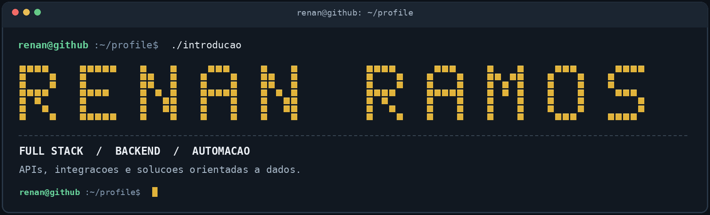

[Portfólio](https://rrenanramos.vercel.app/) &nbsp; • &nbsp; [LinkedIn](https://www.linkedin.com/in/renan-ramos-068759243/) &nbsp; • &nbsp; [Repositórios](https://github.com/Draxsd3?tab=repositories)

---

### Olá, eu sou o Renan 👋

Sou desenvolvedor Full Stack com foco em **backend, integrações e automação**. Gosto de entender o problema antes de escolher a tecnologia e de criar soluções que façam sentido para quem as utiliza.

Nos meus projetos, exploro desde a modelagem de regras e contratos de API até persistência, testes e ambientes de desenvolvimento reproduzíveis.

`APIs REST` &nbsp; `Sistemas orientados a dados` &nbsp; `Automação de processos`

---

### Projetos em destaque

#### [01 / ValiSign Tech Showcase ↗](https://github.com/Draxsd3/valisign-tech-showcase)

Uma vitrine técnica dos padrões de uma plataforma de contratos e assinaturas: ciclo de solicitações, regras de transição, esquema de auditoria e verificações automatizadas. **Não é a aplicação de produção.**

`FastAPI` `React` `PostgreSQL` `GitHub Actions`

#### [02 / Commerce Hub API ↗](https://github.com/Draxsd3/commerce-hub-api)

API REST para um cenário de e-commerce, organizada em módulos de autenticação, usuários, produtos e pedidos, com documentação Swagger. A autenticação é simplificada para desenvolvimento.

`Python` `Flask` `SQLAlchemy` `PostgreSQL` `Docker`

#### [03 / FutManager ↗](https://github.com/Draxsd3/FutManager)

Sistema web para gestão de futebol desenvolvido com Next.js e TypeScript.

`Next.js` `TypeScript`

#### [04 / Spring Boot Docker CI ↗](https://github.com/Draxsd3/springboot-docker-ci)

Projeto de API com testes automatizados, build Maven, containers e fluxo de integração contínua.

`Java` `Spring Boot` `JUnit` `Docker` `GitHub Actions`

[Ver todos os repositórios →](https://github.com/Draxsd3?tab=repositories)

---

### Tecnologias e ferramentas

**Backend** &nbsp; Python · FastAPI · Flask · Node.js · Laravel · Spring Boot  
**Frontend** &nbsp; React · Next.js · TypeScript  
**Dados** &nbsp; PostgreSQL · MySQL · MongoDB · SQLAlchemy  
**Entrega** &nbsp; Docker · Docker Compose · Git · JUnit · CI/CD  
**Automação** &nbsp; n8n · APIs · workflows · IA aplicada

---

### Vamos conversar?

Tenho interesse em oportunidades e projetos de **backend, desenvolvimento full stack e automação**.

[Conheça meu portfólio](https://rrenanramos.vercel.app/) &nbsp; • &nbsp; [Conecte-se no LinkedIn](https://www.linkedin.com/in/renan-ramos-068759243/)
